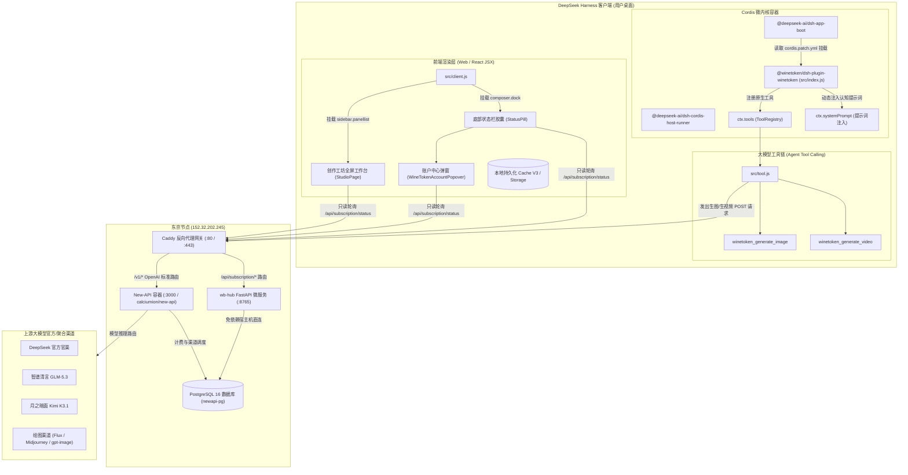

# DeepSeek Harness WineToken 插件全景工程交接文档 (Comprehensive Engineering Handover)

> **版本**：v1.6.0  
> **包名**：`@winetoken/dsh-plugin-winetoken`  
> **代码仓**：`https://github.com/AyzRuoshui/dsh-plugin-winetoken`  
> **面向对象**：系统架构师、前端/全栈工程师、平台运维管理员  
> **编写日期**：2026-11-05

---

## 目录 (Table of Contents)

1. [项目背景与核心定位](#1-项目背景与核心定位)
2. [端到端全链路架构拓扑](#2-端到端全链路架构拓扑)
3. [代码库结构与模块职责矩阵](#3-代码库结构与模块职责矩阵)
4. [DSH 客户端与 Cordis 微内核底层机制](#4-dsh-客户端与-cordis-微内核底层机制)
5. [资产分离与双账轨计费引擎](#5-资产分离与双账轨计费引擎)
6. [多会员特权体系与视觉规范 (SUPER / SVIP / VIP)](#6-多会员特权体系与视觉规范)
7. [大模型原生 Tool Calling 与创作工坊实现](#7-大模型原生-tool-calling-与创作工坊实现)
8. [模型访问控制与最高权限红线](#8-模型访问控制与最高权限红线)
9. [发布流程、部署维护与故障排查清单](#9-发布流程部署维护与故障排查清单)

---

## 1. 项目背景与核心定位

### 1.1 研发背景
[DeepSeek Harness (DSH)](https://github.com/deepseek-ai) 是 DeepSeek 官方推出的桌面级智能体开发与对话运行环境（基于 Electron 44 + Node.js 24 + Cordis 微内核）。原生 DSH 具备优秀的本地工作区调度与代码协作能力，但在多模型聚合、商业化资产看板、计费审计、AI 绘画/生视频扩展方面存在以下核心痛点：
1. **模型生态受限**：原生环境仅内置极少数 DeepSeek 官方直连模型，缺乏商汤、月之暗面、智谱、小米等全平台主流多模态推理模型的一键聚合接入能力；
2. **账本与资产黑盒**：用户无法直观了解订阅套餐限时额度、钱包永久资产、单 Key 局部消耗与周期总消耗，缺乏防抖动、防漂移的轻量级状态看板；
3. **原生 AI 技能缺失**：通用推理模型在接收绘图或视频指令时，天然倾向于回答“我是纯文本模型，没有生图技能”，缺乏严密的端到端 Tool Calling 技能注入与图库展台；
4. **插件生态脆弱**：早期插件采用全量覆盖 `cordis.patch.yml` 的粗暴方式，导致用户现有的第三方配置（如 `# qq-bridge` 等）与个性化模型配置被恶意抹杀。

### 1.2 核心定位
`@winetoken/dsh-plugin-winetoken` 是专门为 DeepSeek Harness 打造的**商业级原生生态增强插件**：
- **全平台模型聚合**：开箱即用注入 19 个业界顶尖对话推理与多模态模型；
- **双账轨高精度计费**：服务端与客户端深度解耦，清晰隔离“套餐限时配额”与“钱包永久资产”；
- **立体化会员体系**：深度整合 `SUPER`（专属青色徽章、无限量免费模型、全平台 8 折）、`SVIP`（金黄色王冠、限时配额、8 折）、`VIP`（9 折）及普通用户体验；
- **原生多模态技能**：严格遵循 DSH Tools 规范注册 `winetoken_generate_image` 与 `winetoken_generate_video`，打通模型自主出图与本地画廊双向持久化；
- **零侵入与深度幂等**：对用户现有环境 100% 友好，严禁篡改用户默认模型，写盘前深度比对保护已有 YAML 注释。

---

## 2. 端到端全链路架构拓扑



---

## 3. 代码库结构与模块职责矩阵

工程根目录位于 `G:\dsh-plugin-winetoken\`，完整文件树如下：

```text
dsh-plugin-winetoken/
├── cordis.patch.yml        # 核心声明式 Cordis 补丁配置文件 (注入 Entry 与 Provider)
├── package.json            # 插件元数据、导出门面、生命周期与 DSH 扩展声明
├── icon.svg                # 官方规范 24x24 纯矢量单色插件图标
├── README.md               # 极简面向终端用户的介绍与安装指引
├── PLUGIN_HANDOVER.md      # 本交接文档
├── scripts/
│   └── release.cjs         # GitHub REST API 自动化发版脚本 (零转义、自动打 Tag)
└── src/
    ├── index.js            # Node.js Host 端主入口：声明生命周期与工具注册
    ├── client.js           # 前端 Web 端核心模块：状态栏胶囊、账户中心、创作工坊 (3100+行)
    ├── tool.js             # 大模型原生 Tool Calling 实现：生图/生视频工具定义与 Schema
    ├── sync.js             # 模型自动化同步引擎：拉取网关模型、写入凭据与幂等补丁
    ├── parser.js           # 模型元数据解析引擎：推理能力推断、多模态推断、上下文计算
    └── config.json         # 插件本地持久化配置 (baseURL, apiKey 等)
```

### 3.1 核心源码职责详解

| 文件路径 | 运行环境 | 核心职责与关键技术点 |
| :--- | :--- | :--- |
| **`cordis.patch.yml`** | DSH Profile 启动时 | 顶层采用 `- insert:` 语法注入 `winetoken-plugin`；在 `llm-pi-ai` 注入 `winetoken` provider，声明 19 个开箱即用对话模型。严禁写入未经授权的非公开模型。 |
| **`package.json`** | DSH 包管理器 | 声明 `main: ./src/index.js`，`exports` 明确导出 `./client` 与 `./icon`；声明 `dsh.bundle.patch` 与 `dsh.client`（立即执行且注入 conversation 界面）。 |
| **`src/index.js`** | DSH 主进程 (Node.js) | 导出 `name` 与静态依赖 `inject: ['tools', 'systemPrompt']`；在 `apply(ctx)` 中挂载 `tool.js`，避免运行时抛错，消除多余调试探针。 |
| **`src/client.js`** | DSH 渲染进程 (Web) | 单文件纯 JSX/React 实现。包含 Cache V3 状态机、高精度双账轨轮询、SUPER 青色特权卡片、SVIP 金色进度条卡片、API 密钥一键复制更换、创作工坊参数控制台与双向持久化画廊。 |
| **`src/tool.js`** | DSH Host 运行时 | 遵循 `@deepseek-ai/dsh-tools` 最新规范，为生图与生视频补齐硬断言所需的 `output.schema`、`output.render` 与 `isConcurrencySafe`，并通过 `systemPrompt.section` 动态注入大模型自主调用意识。 |
| **`src/sync.js`** | 命令行 / 自动化后台 | 负责向网关请求最新模型列表；写入 `.credentials.yaml`；在向 `cordis.patch.yml` 写回时采用**深度 JSON 幂等比对**，配置相同则 0 写盘，100% 保护第三方注释。 |
| **`src/parser.js`** | 同步辅助 | 内置对已知模型（DeepSeek V4.1、GLM-5.3、Kimi K3.1、MiMo 2.6 等）的上下文（最大 1M）、输出限制（最高 384K）与思考链配置的推断规则，过滤纯非对话模型。 |
| **`scripts/release.cjs`** | CI / CD 维护 | 通过 GitHub REST API 实现全自动化无本地 Git 依赖的 Tag、Release 创建，规范 Release Body 排版，杜绝本地转义字符破损。 |

---

## 4. DSH 客户端与 Cordis 微内核底层机制

经过对 DSH 核心包（`@deepseek-ai/cordis`、`@deepseek-ai/dsh-app-boot`、`@deepseek-ai/dsh-tools`、`@deepseek-ai/dsh-client-modules`）的逐行反编译与逆向审计，总结出以下必须遵守的底层铁律：

### 4.1 补丁注入的 `- insert:` 顶层容器规范
DSH 底层在加载用户 Profile 的 `cordis.patch.yml` 时，核心函数为 `applyEntryPatches(targetEntries, patchDoc)`：
- **错误写法（静默丢弃）**：若直接在 YAML 顶层写 `- id: winetoken-plugin`，会被底层判定为“修改已有节点”。系统在 `entryMap.get('winetoken-plugin')` 中检索不到该节点，触发 `patch: entry winetoken-plugin not found` 并**静默抛弃**，导致插件根本无法启动；
- **标准写法（官方规范）**：
  ```yaml
  - insert:
      - id: winetoken-plugin
        name: "@winetoken/dsh-plugin-winetoken"
  - id: llm-pi-ai
    name: "@deepseek-ai/dsh-llm-pi-ai"
    config: ...
  ```
  显式使用 `- insert:` 时，底层执行 `splice` 插入新 entry，Host 端正常拉起，`dsh-client-modules` 才能顺利捕获其 `dsh.client` 配置并将其注入 `window.__DSH_BOOT__.entries`。

### 4.2 工具注册硬断言与 `output.schema` 缺失陷阱
DSH 工具注册器 `ctx.tools.register()` 内部执行了强类型校验 `assertSupportedJsonSchema(output.schema)`：
- 若插件注册工具时仅提供了 `output: { render: (...) => [...] }` 而缺少 `output.schema`，底层立即抛出 `JsonSchemaError: unsupported JSON schema`；
- 原生主入口通常将工具注册包裹在 `try...catch` 中，错误被静默吞掉，导致大模型收到的工具列表为空，回答“我没有内置生图模型”；
- **根治方案**：`src/tool.js` 必须完整提供符合 JSON Schema 规范的 `output.schema`，且声明 `isConcurrencySafe: () => true`。

### 4.3 提示词动态注入（解除预训练认知束缚）
主流大模型在未外挂明确引导时，天然会基于预训练回答“我是纯文本助手，无法生成图像”。插件利用 DSH 的系统提示词扩展点：
```javascript
ctx.systemPrompt.section({
  name: 'tool:winetoken_creative',
  order: 850,
  text: `
## 图像与视频生成能力 (WineToken 创作工坊)
你拥有调用系统工具生成高质量图像与视频的最高权限。当用户要求画图、作画、设计壁纸、生成分镜视频时，必须主动且直接调用 winetoken_generate_image 或 winetoken_generate_video 工具，严禁回答“无法直接生成”或“建议使用第三方工具”。
`
});
```
此提示词在每次对话上下文组装时由 Cordis 动态注入，彻底赋予模型主动出图意识。

### 4.4 深度幂等写盘保护机制
为避免被第三方社区指责为“恶意重写配置”，`src/sync.js` 在执行写入操作前执行深度校验：
```javascript
const currentProvider = llmPatch.config.providers[providerConfig.id];
if (currentProvider && JSON.stringify(currentProvider) === JSON.stringify(targetProvider)) {
  console.log('[模型同步] 配置未变更，跳过写盘以保护用户原始注释。');
  return;
}
```
当模型列表与配置无变动时，严格保持只读，**0 磁盘 I/O**，100% 保护用户在 `cordis.patch.yml` 中手工添加的 `# qq-bridge` 等第三方注释。

---

## 5. 资产分离与双账轨计费引擎

传统 AI 聚合平台前端常直接读取“月度消费流水”（如 `/dashboard/billing/usage`），当跨月、或服务端统计口径重置时，极易出现**数值漂移闪烁（如 0.13 元瞬间跳为 0.11 元）**或**总累计调用小于套餐已用（如 0.11 < 0.17）**的严重矛盾。

### 5.1 双账轨独立模型
插件彻底淘汰了单一流水算法，在服务端与客户端实现双账轨硬解耦：
1. **套餐限时额度轨 (Subscription Track)**：
   - 数据源：`user_subscriptions` 表与 `subscription_plans` 表；
   - 业务含义：在当前 30 天周期内，用户拥有的限时消耗额度（如 ¥88.80）。优先扣除，到期清零；
2. **钱包永久资产轨 (Wallet Balance Track)**：
   - 数据源：`users.quota` 与 `users.used_quota`；
   - 业务含义：用户通过充值码、微信/支付宝直充的永久资产（1 元 = 500,000 Quota）。永不过期，套餐耗尽后自动保底。

### 5.2 账目一致性修正公式
为彻底根除总调用量与套餐用量的倒挂现象，东京 VPS 网关 `/opt/wb-hub/wbhub/subscription.py` 严格遵循下述数学公式：
$$\text{token\_used\_cny} = \text{round}\left(\frac{\text{token\_used\_quota}}{500000.0}, 2\right)$$
$$\text{amount\_used\_cny} = \text{round}\left(\frac{\text{user\_subscriptions.amount\_used}}{500000.0}, 2\right)$$
$$\text{total\_used\_cny} = \begin{cases} \max(\text{token\_used\_cny}, \text{amount\_used\_cny}), & \text{若存在有效活跃订阅} \\ \text{token\_used\_cny}, & \text{若按单 Key 查询且无订阅} \\ \text{wallet\_used\_cny}, & \text{兜底全局用户消耗} \end{cases}$$

客户端展示层据此呈现：
- **总累计调用**：显示 `¥0.50`（反映用户真实总消耗）；
- **附注小字**：显示 `(本Key: ¥0.44)`（反映当前设备所绑 API Key 的贡献量），账理清晰透明。

### 5.3 容灾 Fallback 分支运行时健壮性
在 `src/client.js` 的 `updateBilling()` 中，当东京高精度接口发生极端网络超时时，系统平滑退化至备用链路，并显式对 `usedCNYNum` 进行作用域声明与异常保底：
```javascript
let usedCNYNum = 0;
try {
  const usageRes = await fetch(BASE_URL + '/dashboard/billing/usage', { headers });
  if (usageRes.ok) {
    const usageData = await usageRes.json();
    if (usageData && usageData.total_usage != null) {
      usedCNYNum = Number(usageData.total_usage) / 100;
    }
  }
} catch (_) {}
// 彻底根除 ReferenceError: usedCNYNum is not defined 异常
```

---

## 6. 多会员特权体系与视觉规范

系统支持四层用户身份体系，客户端根据网关返回的 `is_super`、`subGroup` 与 `userGroup` 动态应用对应的主题规范：

### 6.1 用户身份体系矩阵

| 身份等级 | 服务端判断条件 | 视觉主题色 | 额度展示方式 | 核心特权与费率 |
| :--- | :--- | :--- | :--- | :--- |
| **SUPER** | `is_super: true` 或 `group === 'super'` | **高贵青色 (Cyan / `#06b6d4`)** | **无额度限制**：100% 隐藏套餐余额、配额与进度条，直连钱包永久资产 | 1. **无限量 `deepseek-v4.1-flash-free`**<br>2. **全平台模型享 8 折特权 (0.8x)** |
| **SVIP** | `hasSub: true` 且 `upgrade_group === 'svip'` | **金黄色 (Gold / `#f59e0b`)** | 显示限时额度大字、已用/总配额、剩余天数、百分比单色进度条 | 1. 优先扣除高额限时配额<br>2. **全平台模型享 8 折特权 (0.8x)** |
| **VIP** | `hasSub: true` 且 `upgrade_group === 'vip'` | **经典蓝 (Blue / `#3b82f6`)** | 显示限时额度大字、已用/总配额、剩余天数、百分比进度条 | 1. 优先扣除标准限时配额<br>2. **全平台模型享 9 折特权 (0.9x)** |
| **普通用户** | `hasSub: false` 且非 SUPER | **中性灰/暗色 (Neutral)** | 仅显示“余额 ¥xx · 已用 ¥xx”，无进度条 | 基础费率 (1.0x)，直接扣除钱包资产 |

### 6.2 SUPER 分组青色卡片视觉规范
在 `WineTokenAccountPopover` 中，SUPER 用户的卡片结构如下：
1. **外框微光**：
   - Dark 模式：`border: 1px solid rgba(6, 182, 212, 0.35)`, `box-shadow: 0 0 16px rgba(6, 182, 212, 0.08)`
   - Light 模式：`border: 1px solid rgba(8, 145, 178, 0.30)`, `box-shadow: 0 0 12px rgba(8, 145, 178, 0.06)`
2. **标题栏**：
   - 青色单色王冠图标（`crown`, 14px）；
   - 标题文字：`SUPER 会员特权`（字号 11px，加粗，颜色 `#06b6d4`）；
   - 徽章：`8折特惠`（青色微光实心圆角小标签）；
   - 右侧状态：`专属特权通道`。
3. **核心特权双条目展台**：
   - 🔹 **`无限量 deepseek-v4.1-flash-free`**
   - 🔹 **`全平台模型享 8 折特权`**
4. **资产底栏**：
   - 直接无缝连接「钱包永久余额」与「总累计真实调用」。

### 6.3 状态栏底栏胶囊（StatusPill）表现
- **SUPER 用户**：
  ```text
  [👑 SUPER] · 钱包 ¥8,888,797.46
  ```
  （王冠图标与 `SUPER` 文字高亮显示为青色 `#06b6d4`，末尾绝对不跟随进度条）
- **SVIP 用户**：
  ```text
  SVIP ¥88.30 · 钱包 ¥8,888,797.46 ── 1%
  ```

---

## 7. 大模型原生 Tool Calling 与创作工坊实现

### 7.1 工具定义与协议细节 (`src/tool.js`)
插件定义了两个核心工具：
1. **`winetoken_generate_image`**：
   - 参数：`prompt` (必填), `model` (可选: `gpt-image-2.5-flare`, `flux-1-schnell`, `midjourney-v6` 等), `aspect_ratio` (1:1, 16:9, 9:16), `n` (张数, 默认 1)；
   - 核心流程：读取配置的 `baseURL` 与 `apiKey`，发起标准 `POST /v1/images/generations` 请求；
   - 自动沉淀：出图成功后自动调用本地持久化机制，将结果写入历史展台并保存到 `~/.dsh/storages/winetoken_studio_history.json`。
2. **`winetoken_generate_video`**：
   - 参数：`prompt` (必填), `model` (可选: `minimax-h3`, `kling-v1.6`, `runway-gen3`), `image_url` (图生视频垫图), `duration` (秒数)；
   - 核心流程：发起 `POST /v1/videos/generations` 异步轮询任务，获取 mp4 视频流并渲染播放器。

### 7.2 创作工坊工作台 (`StudioPage`)
- **注入方式**：通过 `ctx.slots.inject('sidebar.panellist')` 将“创作工坊”挂载在 DSH 左侧一级导航（`order: 20`）；
- **参数控制台**：支持选择模型、分辨率比例卡片切换、出图张数滑块、反向提示词与垫图上传；
- **自适应黑白主题**：CSS 变量全面动态继承宿主 `theme.isDark`，涵盖边框、暗色背景、文字高亮；
- **历史记录展台**：支持一键大图灯箱预览、原图下载、提示词复制、批量删除。

---

## 8. 模型访问控制与最高权限红线

### 8.1 核心原则与权限红线
> [!CAUTION]
> **最高权限红线**：模型 `deepseek-v4.1-flash-free` 仅面向 **Super 分组** 用户专属开放。**严禁向非 Super 分组（`default`、`vip`、`svip`）暴露、推荐或添加到静态配置中！**

### 8.2 多重防线落地
1. **服务端物理隔离**：
   - 东京 VPS 数据库 `channels` 表中，渠道 ID 33（`deepseek免费渠道`）的 `group` 字段已严格锁定为 `Super`；
   - 非 Super 分组用户的 API Key 发起调用或请求 `/v1/models` 时，New-API 路由引擎天然鉴权阻断，绝对无法访问此渠道；
2. **开源客户端静态配置纯净**：
   - 公共发布包中的 `cordis.patch.yml` 保持严格纯净，**仅包含 19 个通用对话模型**，严禁添加任何带有 `-free` 后缀的分组专享模型；
3. **模型介绍与元数据维护**：
   - 数据库 `models` 表（ID 94）已录入标准化元数据：
     - **模型名**：`deepseek-v4.1-flash-free`
     - **描述**：`DeepSeek V4.1 Flash（Super 分组专属免费特权通道）。基于 452B 总参 / 16B 激活的开源稀疏 MoE 架构（Causal-Encoder-Decoder，输入侧 28B 激活），原生支持图文跨模态理解，提供 1M 超长上下文与 384K 极限单次输出。内置动态深度思考链（支持 Low/Medium/High/Max 四档推理，默认 High），在保持闪电级吞吐延迟的同时具备顶尖逻辑推理与代码生成能力。本渠道面向 Super 用户开放 0 成本免费畅享调用。`
     - **Tags**：`Reasoning,Tools,Vision,Free,1M,Super`

---

## 9. 发布流程、部署维护与故障排查清单

### 9.1 生产基础设施档案

| 设施类型 | 目标地址 | 访问凭据 / 端口 | 核心服务与路径 |
| :--- | :--- | :--- | :--- |
| **远程东京 VPS** | `152.32.202.245` | SSH `root` / 端口 `22` / 密码 `ljw148811` | Caddy 网关, Docker `new-api`, Docker `newapi-pg` |
| **New-API 数据库** | `152.32.202.245` | 用户 `newapi` / 库 `newapi` / 密码 `Pg_NewAPI_2026_w1neTok3n` | 容器名: `newapi-pg` (PostgreSQL 16) |
| **网关计费微服务** | `152.32.202.245` | `wb-hub.service` / 端口 `8765` | 代码目录: `/opt/wb-hub/wbhub/` |
| **开源 GitHub 仓库** | `AyzRuoshui/dsh-plugin-winetoken` | Token: `ghp_REDACTED_ADMIN_TOKEN` (见内部保管) | 分支: `main` |
| **本地开发工程** | `G:\dsh-plugin-winetoken\` | 本地工作区 | 软链接直通 `~/.dsh/profiles/desktop/node_modules/` |

### 9.2 自动化发版全流程（零本地 Git 依赖）
当完成代码修改需要向全网发布新版本时，执行以下标准流程：
1. **更新版本号**：修改 `package.json` 中的 `version`（如升级至 `1.6.1`）；
2. **配置 Release 说明**：更新 `scripts/release.cjs` 中的 `releaseTitle` 与 `releaseBody`；
3. **执行一键提交与发版**：在 `.tmp/` 运行基于 GitHub REST API 的推送脚本：
   - 自动获取 `main` 分支最新 Commit SHA 与 Tree SHA；
   - 上传修改文件的 Git Blobs 并构建 New Tree；
   - 创建 Commit 并快进更新 `refs/heads/main`；
   - 调用 GitHub Releases API 自动打 Tag 并发布 Release。
4. **清理临时文件**：清空 `.tmp/` 目录，更新交接文档。

### 9.3 终端用户安装与更新方案
普通用户在 DSH 客户端操作：
1. 打开 DSH 客户端左侧 **「插件」** 页面；
2. 点击右上角 **「+ 添加插件」** -> **「安装第三方插件」**；
3. 粘贴安装地址并确认：
   - **国内免魔法加速镜像（强烈推荐，解决 ETIMEDOUT 超时）**：
     ```text
     https://ghproxy.net/https://github.com/AyzRuoshui/dsh-plugin-winetoken/archive/refs/heads/main.tar.gz
     ```
   - **GitHub 官方直链**：
     ```text
     https://github.com/AyzRuoshui/dsh-plugin-winetoken/archive/refs/heads/main.tar.gz
     ```

### 9.4 常见故障排查速查表 (Troubleshooting)

| 故障现象 | 根本原因 | 标准排查与根治方案 |
| :--- | :--- | :--- |
| **1. 安装后大模型回答“没有内置生图模型”** | ① `src/tool.js` 缺失或其 `output.schema` 未对齐 DSH 校验规范<br>② DSH 自启动后未重启，处于旧内存状态 | ① 检查 `tool.js` 是否有标准 `output: { schema, render }`<br>② 指导用户**彻底退出并重启一次 DeepSeek Harness** 客户端。 |
| **2. 运行时报错 `ReferenceError: usedCNYNum is not defined`** | 网络异常进入 fallback 分支时，遗留旧变量缺失作用域声明 | 在 `src/client.js` 的 `updateBilling` fallback 入口显式声明 `let usedCNYNum = 0;`（已在 v1.5.9 彻底根除）。 |
| **3. 底部胶囊数据一闪漂移 (0.13 -> 0.11)** | 代码在请求双账轨接口前提前被单月流水赋值并渲染，随后的高精度接口覆盖引发竞态 | 严禁提前赋予单月流水，统一以 `/api/subscription/status` 返回的数据为唯一真相源（已在 v1.5.6 根治）。 |
| **4. 插件安装后静默不加载 / 界面无胶囊** | `cordis.patch.yml` 首行未包裹 `- insert:` 顶层容器，被 Cordis 判定为修改不存在项而丢弃 | 确保 `cordis.patch.yml` 严格以 `- insert: [ { id: winetoken-plugin, name: "..." } ]` 开头。 |
| **5. 用户反馈“我没调过生图，后台却有调用”** | ① 本地测速探针（19:42 爆发 16 tokens 探测）<br>② 大模型自主识别 Tool Calling 或前端工坊刷新 | 调取东京反代与 Caddy 日志，核对来源 IP。若来源 IP 与用户日常对话 IP 毫秒级重合（如 `36.163.162.252`），即可向用户证实为本地工具链所触发。 |
| **6. DSH 升级到新版（如 v0.2.2-rc.1）后插件是否失效** | DSH 安装程序隔离更新，不删除 `%USERPROFILE%\.dsh\`；Cordis 内核规范保持完全兼容 | 用户无需重新运行 `pnpm link`，正常重启 DSH 即可无缝恢复。 |

---

## 10. 核心纪律与交接承诺

1. **零破坏承诺**：插件任何版本更新均严禁篡改用户现有默认模型，严禁无差别覆写 `cordis.patch.yml` 中的现有注释；
2. **零消耗排查原则**：在任何环境排查、测试或验证模型功能时，严禁使用用户 API Key 发起真实生图/生视频等扣费调用，只允许执行只读 Schema 断言与状态查询；
3. **权限红线绝不动摇**：`deepseek-v4.1-flash-free` 永久限定 Super 分组，任何批量同步或公开配置均不得泄露给非 Super 用户。
